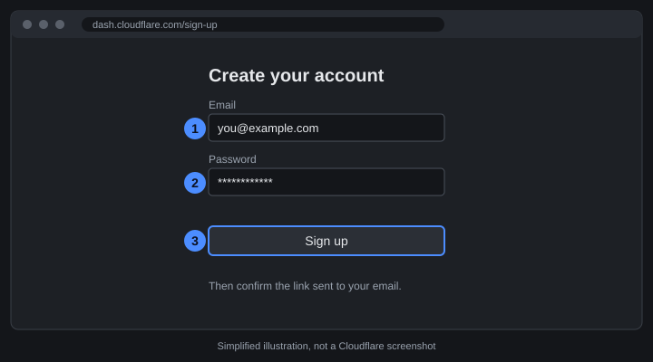
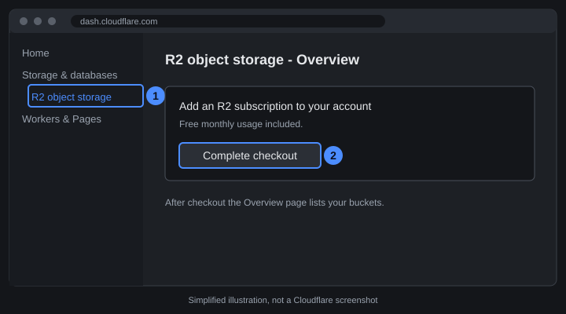
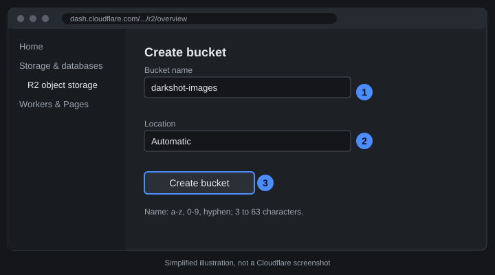
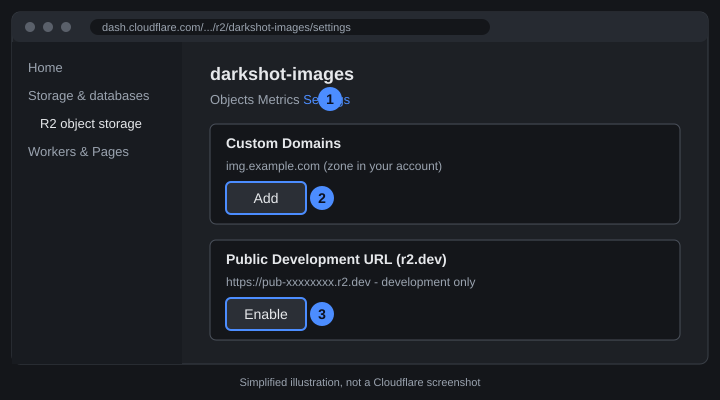
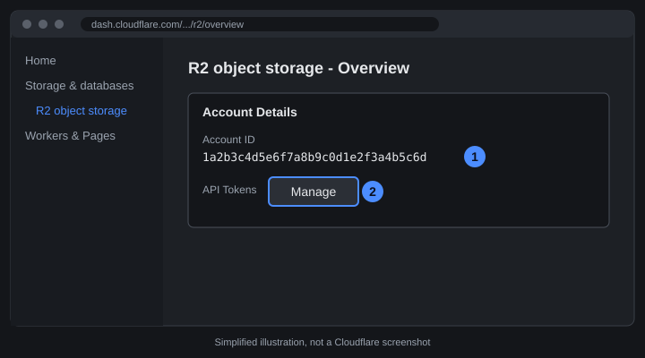
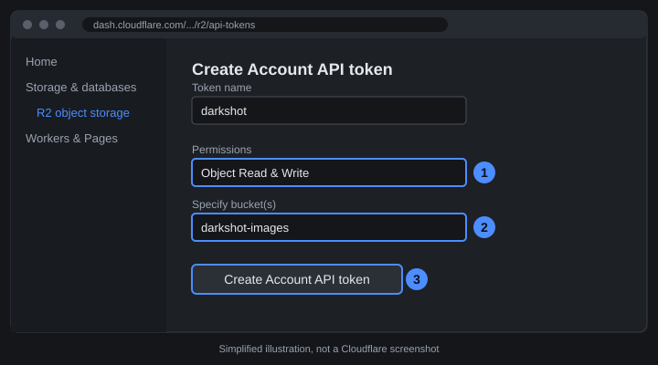
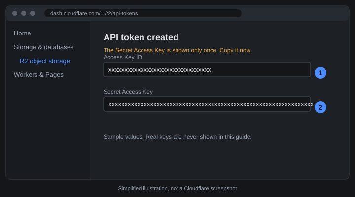
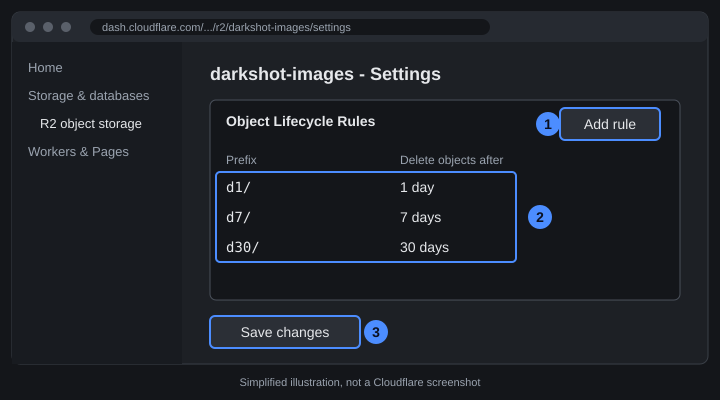
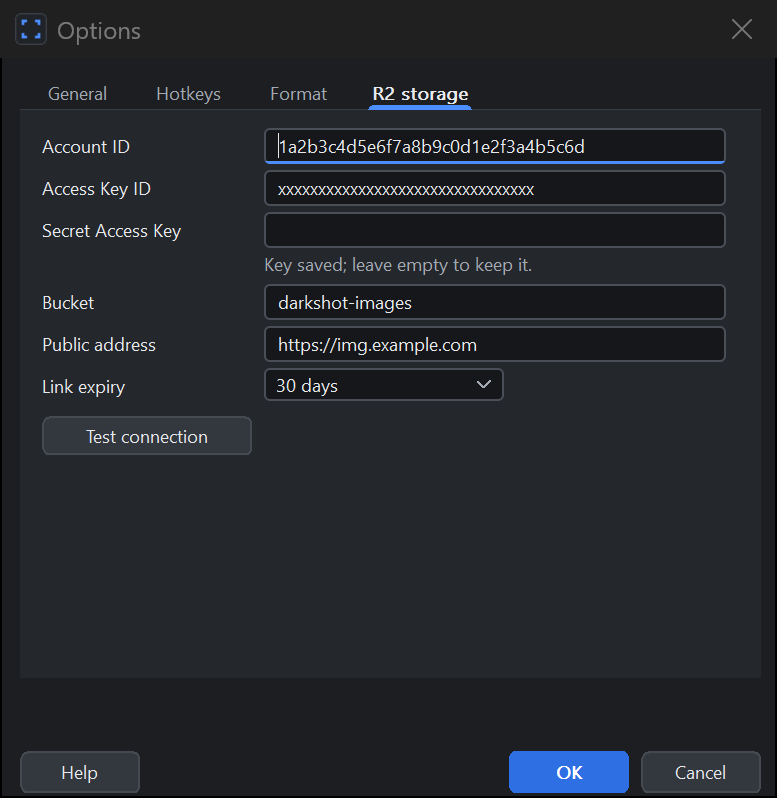

[Tiếng Việt](r2-setup.md) | [English](r2-setup.en.md)

# Setting up Cloudflare R2 and configuring darkshot

A step-by-step guide: create a Cloudflare account, enable R2, create a bucket, turn on public access, create an API key, set up automatic deletion, and enter everything in darkshot. When you are done, pressing `Ctrl+D` after a capture uploads the image to your own bucket and copies the link to the clipboard.

The Cloudflare pictures below are simplified wireframes that show where to click. They are not screenshots of the Cloudflare interface. The numbers in blue circles match the numbered items in each step. All values in the pictures are samples. The real interface may look slightly different.

## 1. Before you start

You need:

- A working email address (to verify your Cloudflare account).
- Possibly a payment method: Cloudflare's documentation only says you complete a checkout flow to add an R2 subscription to your account. It does not say whether a card is required. Follow whatever Cloudflare shows you at that point.
- If you want nice links like `https://img.yourdomain.com/...`: a domain already added to Cloudflare (a zone in the same account). Without one, use the free `r2.dev` address, which is meant for testing only (see step 5).

Free monthly usage according to Cloudflare's pricing page (checked on 2026-11-23, applies to the Standard storage class only):

| Item | Free each month |
|---|---|
| Storage | 10 GB-month |
| Class A operations (for example uploads) | 1 million requests |
| Class B operations (for example reads) | 10 million requests |
| Egress (data out) | Free |

Limits and prices can change. Check the official pricing page (section 12) before heavy use.

## 2. Create a Cloudflare account

1. Open https://dash.cloudflare.com/sign-up.
2. Enter your **Email** and **Password**, then click **Sign up**.
3. Open the email Cloudflare sent and click the verification link. Then sign in to the dashboard.

Expected result: you are in the Cloudflare dashboard. If you already have an account, sign in and go to step 3.

## 3. Enable R2

1. In the left menu open **Storage & databases**, then choose **R2 object storage** (**Overview**).
2. If Cloudflare asks, complete the checkout / sign-up for the R2 plan (a button like **Complete checkout**). According to Cloudflare's documentation, R2 includes free monthly usage; usage beyond that is billed monthly.

Expected result: the R2 **Overview** page appears with an empty list of buckets.

## 4. Create a bucket

1. On the R2 **Overview** page, click the create-bucket button (**Create bucket**).
2. Type a bucket name, for example `darkshot-images`. Cloudflare's rules: lowercase letters `a-z`, digits `0-9` and hyphens `-` only; 3 to 63 characters; it must not start or end with `-`.
3. **Location**: **Automatic** is fine.
4. Click **Create bucket**.

Expected result: the new bucket is in the list. Cloudflare's documentation does not describe each button of this step in the dashboard; if a button is named differently, look for the create-bucket button on the R2 page.

## 5. Turn on public access and get the Public address

Images must open in a browser, so the bucket needs public access. Open the bucket, choose the **Settings** tab, then pick one of the two ways.

**Option A: your own domain (recommended for long-term use)**

1. Under **Custom Domains**, click **Add**.
2. Enter the domain (it must already be a zone in the same Cloudflare account), click **Continue**, review the DNS record that will be added, then click **Connect Domain**.
3. Wait for the status to change from **Initializing** to **Active** (refresh the page if needed).
4. Your **Public address** is `https://` plus the domain, for example `https://img.example.com`.

**Option B: r2.dev (testing only; Cloudflare says it is for development)**

1. Under **Public Development URL**, click **Enable**.
2. In the **Allow Public Access?** box, type `allow` and click **Allow**.
3. Check that **Public URL Access** shows **Allowed**, then copy the bucket address (like `https://pub-{code}.r2.dev`) from the bucket's settings page. That is your **Public address**.

Notes: option B is rate-limited and meant for non-production traffic; do not create a CNAME pointing at the r2.dev address (Cloudflare does not support it). With either option, Cloudflare does not list the contents at the root of the address; opening each image by its own link still works.

## 6. Create an API token for this bucket only

1. Go back to **R2 object storage**, **Overview**. Under **Account Details**, copy the **Account ID** (a 32-character string, for example `1a2b3c4d5e6f7a8b9c0d1e2f3a4b5c6d`; this one is a sample).
2. Still in **Account Details**, click **Manage** next to **API Tokens**.
3. Click **Create Account API token** (tied to the Cloudflare account) or **Create User API token** (tied to your personal user). Either works with darkshot.
4. Under **Permissions**, choose **Object Read & Write**.
5. In the bucket selector (**Specify bucket**), pick the bucket you just created. If you skip this, the token can access every bucket in the account.
6. Click the create button (**Create Account API token** or **Create User API token**, depending on the type you chose).
7. Cloudflare shows the **Access Key ID** and the **Secret Access Key**. **The Secret Access Key is shown only once.** Copy both right away to a safe place (for example a password manager).

Expected result: you have three values written down: Account ID, Access Key ID, Secret Access Key. If you forgot to copy the Secret Access Key, create a new token; it cannot be shown again.

## 7. Create three lifecycle rules (automatic deletion)

You create these rules on Cloudflare; darkshot does not create them and cannot check them. **If you skip this, images will not expire even if you choose 1 or 7 days in darkshot.**

1. Open the bucket, choose the **Settings** tab, find **Object Lifecycle Rules**, and click **Add rule**.
2. Fill in the rule: a rule name, the **prefix**, and the number of days after which objects are deleted. Cloudflare's documentation does not name the dashboard form fields, so read the real labels on screen.
3. Click **Save changes**.
4. Repeat until you have all three rules:

| Prefix | Delete after |
|---|---|
| `d1/` | 1 day |
| `d7/` | 7 days |
| `d30/` | 30 days |

Do not create a rule for `keep/` (darkshot's "Never expires" choice).

Expected result: reopening **Object Lifecycle Rules** shows exactly three rules with the prefix spelled exactly (including the trailing `/`). According to Cloudflare's documentation, objects are usually deleted within 24 hours after they expire, so an image may stay in the bucket about a day longer.

## 8. Configure darkshot

1. Right-click the darkshot icon in the system tray and choose **Options...**. (On the first run with no configuration, the window opens on this tab by itself.)
2. Choose the **R2 storage** tab and fill it in using this table:

| Value on Cloudflare | Field in darkshot | Example |
|---|---|---|
| Account ID (step 6.1) | **Account ID** | `1a2b3c4d5e6f7a8b9c0d1e2f3a4b5c6d` |
| Access Key ID (step 6.7) | **Access Key ID** | (your key string) |
| Secret Access Key (step 6.7) | **Secret Access Key** | (your key string) |
| Bucket name (step 4) | **Bucket** | `darkshot-images` |
| Public address (step 5) | **Public address** | `https://img.example.com` |
| Pick the folder that matches step 7 | **Link expiry** | 1 day, 7 days, 30 days (default) or Never expires |

3. Click **Test connection** and wait for the message: "Success: the upload worked and the link opens."
4. Click **OK**.

(The picture uses sample values; the Secret Access Key box never shows a saved key again.)

Notes:

- The **Public address** must start with `https://` and contain no spaces; a trailing `/` is removed automatically.
- The next time you open Options, the **Secret Access Key** box shows "Key saved; leave empty to keep it." Leave it empty and click **OK** to keep the old key.
- **Test connection** uploads a test file and then deletes it.

## 9. Try a capture and upload

1. Press `PrintScreen` and drag to select a region.
2. Press `Ctrl+D` (or the upload button on the toolbar).
3. When you see the "Link copied" notification, paste (`Ctrl+V`) into a browser.

The link looks like `{public address}/d30/{16 characters}.png`, for example `https://img.example.com/d30/k3X9f2abQ7mZp1Lw.png` (the `d30` folder follows **Link expiry**; if you pick JPEG on the Format tab the extension is `.jpg`). If the image opens, you are done.

To check the deletion rules, see the "Kiểm tra quy tắc xóa" (checking the deletion rules) section of the [README](../README.md), which is in Vietnamese.

## 10. Troubleshooting

When an upload fails, the image is still saved to your save folder and the "Upload failed" notification gives the reason.

| Message | Usual cause and fix |
|---|---|
| "Fill in Account ID, Access Key ID, Secret Access Key, Bucket and Public address first." | A box on the R2 storage tab is empty. Fill all five and click **Test connection** again. |
| "Storage is not configured. Enter all the details in Options." | R2 is not set up yet. Do step 8. |
| "Account ID may only contain letters, digits and hyphens." | The Account ID was copied wrongly or has spaces or odd characters. Copy it again from **Account Details**. |
| "The bucket name may only contain letters, digits, dots, underscores and hyphens." | The bucket name has an invalid character. Use the exact name from step 4. |
| "The public address must start with https://" (or "is missing a domain after https://", "must not contain spaces", "must not contain ?, # or @") | Fix the public address as in step 5, for example `https://img.example.com`. |
| "The access key is invalid or lacks permission. Check the key." | The Access Key ID or Secret Access Key is wrong, or the token lacks **Object Read & Write**, or it does not apply to this bucket. Create a new token (step 6) and enter both keys again. |
| "Bucket not found. Check the bucket name and account ID." | Wrong bucket name or Account ID. Compare with steps 4 and 6. |
| "The image could not be read through the public address. Check the bucket's public address." | Public access is not on, the domain is not **Active** yet, or the address is wrong. Review step 5. |
| "The system clock is wrong. Fix the date and time in Windows and try again." | The Windows clock is off. Turn on automatic time, then retry. |
| "Could not connect to the server. Check your network and try again." | No network or it is blocked. Check your network, firewall and VPN. |
| "The check timed out. Try again." | Slow network. Try again. |
| "Could not read the saved secret key. Enter the Secret Access Key again." | The config was copied from another Windows account. Enter the Secret Access Key again. |

Images never expire: recheck step 7 (all three rules, exact prefixes, exact days).

## 11. Security

- The **Secret Access Key** is encrypted with Windows DPAPI, tied to the current Windows account, before it is written to `%APPDATA%\darkshot\config.json`; the other fields are stored as plain text.
- Do not share the Access Key ID and Secret Access Key, and do not paste them into screenshots, messages or code repositories.
- If a key leaks: go to **R2 object storage** > **Overview** > **Account Details** > **API Tokens** > **Manage**, revoke (delete) that token, create a new one (step 6) and enter it in darkshot again.
- Anyone with the link can view the image; privacy relies on the random, hard-to-guess name and the link expiry. Do not turn on public listing for the bucket.
- darkshot cannot delete images you have uploaded (it only deletes the test file from **Test connection**). To delete one, open Cloudflare R2, open the bucket and delete the object.

## 12. References

- Get started with R2: https://developers.cloudflare.com/r2/get-started/
- Pricing and free usage: https://developers.cloudflare.com/r2/pricing/
- Create buckets: https://developers.cloudflare.com/r2/buckets/create-buckets/
- Public buckets: https://developers.cloudflare.com/r2/buckets/public-buckets/
- API tokens: https://developers.cloudflare.com/r2/api/tokens/
- Object lifecycles: https://developers.cloudflare.com/r2/buckets/object-lifecycles/

Checked against Cloudflare's documentation on 2026-11-23. The Cloudflare interface may rename buttons; if a name does not match, look for it by the description in the documentation.
