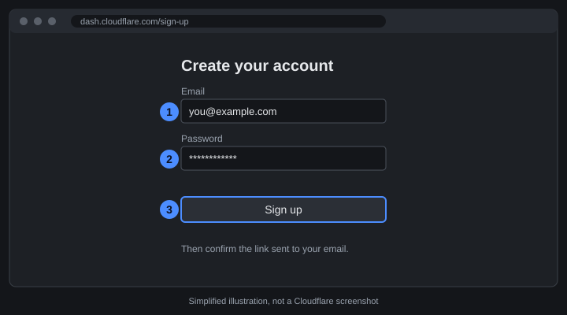
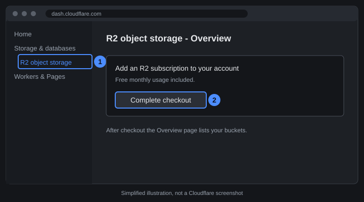
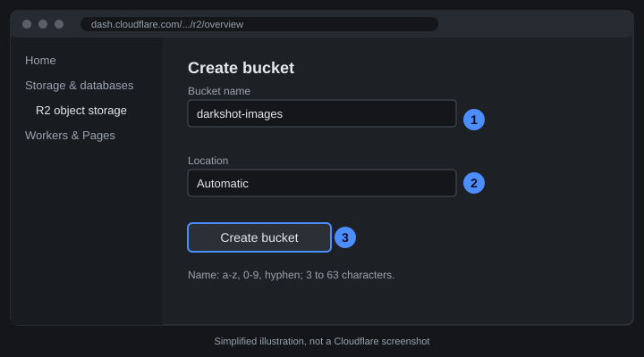
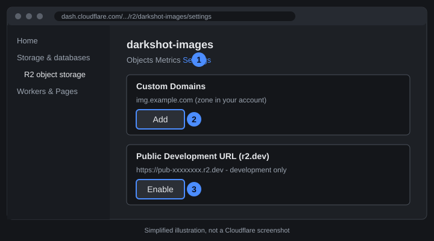
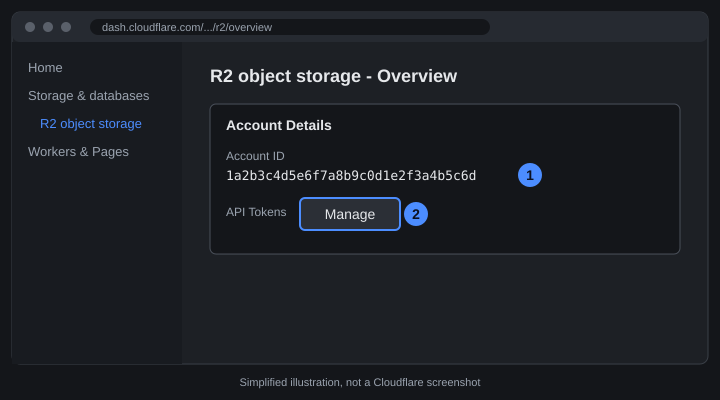
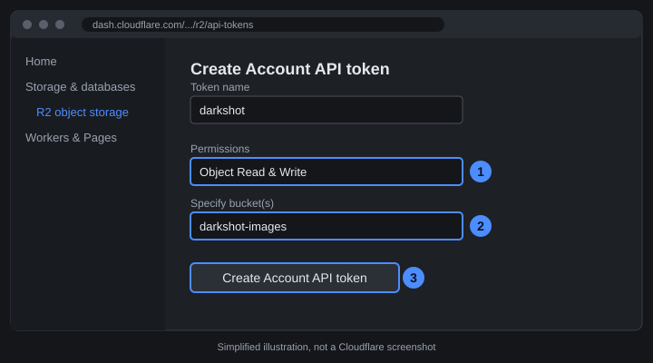
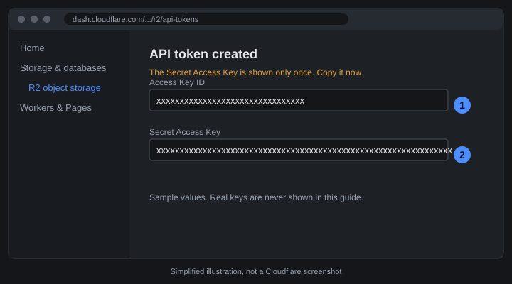
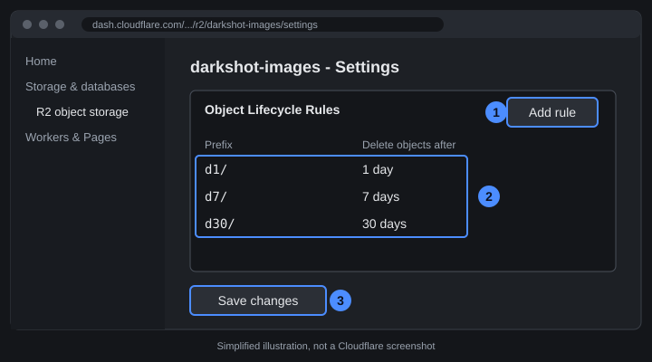
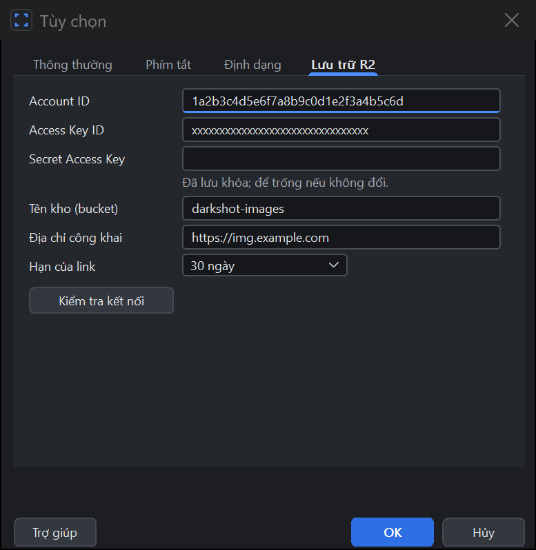

[Tiếng Việt](r2-setup.md) | [English](r2-setup.en.md)

# Hướng dẫn đăng ký Cloudflare R2 và cấu hình darkshot

Hướng dẫn từng bước: tạo tài khoản Cloudflare, bật R2, tạo kho (bucket), mở truy cập công khai, tạo khóa API, đặt quy tắc tự xóa và nhập vào darkshot. Làm xong, bấm `Ctrl+D` sau khi chụp là ảnh được tải lên kho của chính bạn và link được chép vào clipboard.

Các hình của Cloudflare dưới đây là hình vẽ giản lược (wireframe) để chỉ chỗ cần bấm, không phải ảnh chụp giao diện Cloudflare. Số trong vòng tròn xanh khớp với các mục đánh số của từng bước. Giá trị trong hình đều là giá trị mẫu. Giao diện thật có thể khác một chút.

## 1. Trước khi bắt đầu

Bạn cần:

- Một địa chỉ email dùng được (để xác minh tài khoản Cloudflare).
- Có thể phải thêm phương thức thanh toán: tài liệu Cloudflare chỉ nói bạn hoàn tất "checkout flow" để thêm gói R2 vào tài khoản, không nói rõ có bắt buộc thẻ hay không. Cứ làm theo những gì Cloudflare hiện ra lúc đó.
- Nếu muốn link đẹp dạng `https://img.tenmiencuaban.com/...`: một tên miền đã thêm vào Cloudflare (zone trong cùng tài khoản). Không có thì dùng địa chỉ `r2.dev` miễn phí, chỉ nên dùng để thử (xem bước 5).

Hạn mức miễn phí mỗi tháng theo trang giá của Cloudflare (đối chiếu ngày 2026-11-23, chỉ áp dụng cho lớp lưu trữ Standard):

| Mục | Miễn phí mỗi tháng |
|---|---|
| Dung lượng lưu trữ | 10 GB-tháng |
| Thao tác Class A (ví dụ tải lên) | 1 triệu yêu cầu |
| Thao tác Class B (ví dụ đọc) | 10 triệu yêu cầu |
| Băng thông ra (egress) | Miễn phí |

Hạn mức và giá có thể thay đổi; xem trang giá chính thức ở mục 12 trước khi dùng nhiều.

## 2. Đăng ký tài khoản Cloudflare

1. Mở https://dash.cloudflare.com/sign-up.
2. Nhập **Email** và **Password**, bấm **Sign up**.
3. Mở email Cloudflare gửi và bấm liên kết xác minh. Sau đó đăng nhập vào trang quản lý (dashboard).

Kết quả mong đợi: bạn vào được trang quản lý Cloudflare. Nếu đã có tài khoản, đăng nhập rồi sang bước 3.

## 3. Bật R2

1. Trong menu bên trái, mở **Storage & databases**, rồi chọn **R2 object storage** (mục **Overview**).
2. Nếu Cloudflare yêu cầu, hoàn tất thanh toán/đăng ký gói R2 (nút kiểu **Complete checkout**). Theo tài liệu Cloudflare, R2 có sẵn mức dùng miễn phí hàng tháng; phần vượt mức tính phí theo tháng.

Kết quả mong đợi: trang **Overview** của R2 hiện ra, có danh sách bucket (còn trống).

## 4. Tạo bucket

1. Ở trang **Overview** của R2, bấm nút tạo bucket (**Create bucket**).
2. Gõ tên bucket, ví dụ `darkshot-images`. Quy tắc của Cloudflare: chỉ chữ thường `a-z`, số `0-9` và dấu gạch ngang `-`; dài 3 đến 63 ký tự; không bắt đầu hoặc kết thúc bằng `-`.
3. Vị trí (**Location**): để **Automatic** là được.
4. Bấm **Create bucket**.

Kết quả mong đợi: bucket mới nằm trong danh sách. Tài liệu Cloudflare không mô tả từng nút của bước này trên giao diện; nếu tên nút khác, hãy tìm nút tạo bucket ở trang R2.

## 5. Bật truy cập công khai và lấy Địa chỉ công khai

Ảnh phải mở được bằng trình duyệt nên bucket cần truy cập công khai. Mở bucket, chọn tab **Settings**, rồi chọn một trong hai cách.

**Cách A: tên miền riêng (khuyến nghị cho dùng lâu dài)**

1. Ở mục **Custom Domains**, bấm **Add**.
2. Nhập tên miền (phải đã là một zone trong cùng tài khoản Cloudflare), bấm **Continue**, xem lại bản ghi DNS sẽ thêm, rồi bấm **Connect Domain**.
3. Đợi trạng thái chuyển từ **Initializing** sang **Active** (làm mới trang nếu cần).
4. **Địa chỉ công khai** của bạn là `https://` cộng tên miền, ví dụ `https://img.example.com`.

**Cách B: r2.dev (chỉ để thử, Cloudflare nói rõ là dành cho phát triển)**

1. Ở mục **Public Development URL**, bấm **Enable**.
2. Trong hộp **Allow Public Access?**, gõ `allow` rồi bấm **Allow**.
3. Kiểm tra **Public URL Access** hiện **Allowed**, rồi chép địa chỉ bucket (dạng `https://pub-{mã}.r2.dev`) từ trang cài đặt của bucket. Đó là **Địa chỉ công khai**.

Lưu ý: cách B bị giới hạn tốc độ và chỉ dành cho lưu lượng không chính thức; đừng tạo CNAME trỏ tới tên miền r2.dev (Cloudflare không hỗ trợ). Với cả hai cách, Cloudflare không cho liệt kê nội dung ở thư mục gốc của địa chỉ; mở từng ảnh theo link riêng thì vẫn được.

## 6. Tạo API token chỉ cho bucket này

1. Quay lại trang **R2 object storage**, mục **Overview**. Trong phần **Account Details**, chép **Account ID** (chuỗi 32 ký tự, ví dụ `1a2b3c4d5e6f7a8b9c0d1e2f3a4b5c6d`). Đây là giá trị mẫu.
2. Cũng ở **Account Details**, bấm **Manage** bên cạnh **API Tokens**.
3. Bấm **Create Account API token** (gắn với tài khoản Cloudflare) hoặc **Create User API token** (gắn với tài khoản cá nhân của bạn). Cách nào cũng dùng được với darkshot.
4. Ở **Permissions**, chọn **Object Read & Write**.
5. Ở phần chọn bucket (**Specify bucket**), chọn đúng bucket vừa tạo. Nếu bỏ qua, token có quyền trên mọi bucket của tài khoản.
6. Bấm nút tạo token (**Create Account API token** hoặc **Create User API token**, tùy loại bạn chọn).
7. Cloudflare hiện **Access Key ID** và **Secret Access Key**. **Secret Access Key chỉ hiện một lần.** Chép cả hai ngay vào nơi an toàn (ví dụ trình quản lý mật khẩu).

Kết quả mong đợi: bạn có ba giá trị đã ghi lại: Account ID, Access Key ID, Secret Access Key. Nếu lỡ không chép Secret Access Key, tạo token mới; không xem lại được.

## 7. Tạo ba quy tắc vòng đời (tự xóa ảnh)

Quy tắc này do bạn tạo trên Cloudflare; darkshot không tạo và không kiểm tra được. **Nếu không tạo, ảnh sẽ không tự hết hạn dù bạn chọn 1 hoặc 7 ngày trong darkshot.**

1. Mở bucket, chọn tab **Settings**, mục **Object Lifecycle Rules**, bấm **Add rule**.
2. Điền thông tin quy tắc: tên quy tắc, **prefix** và số ngày sau đó đối tượng bị xóa. Tài liệu Cloudflare không nêu tên từng ô của biểu mẫu trên dashboard, nên hãy đọc nhãn thật trên màn hình.
3. Bấm **Save changes**.
4. Lặp lại để có đủ ba quy tắc:

| Prefix | Xóa sau |
|---|---|
| `d1/` | 1 ngày |
| `d7/` | 7 ngày |
| `d30/` | 30 ngày |

Không tạo quy tắc cho `keep/` (lựa chọn "Không hết hạn" của darkshot).

Kết quả mong đợi: mở lại **Object Lifecycle Rules** thấy đúng ba quy tắc, prefix đúng từng chữ (có dấu `/` ở cuối). Theo tài liệu Cloudflare, đối tượng thường bị xóa trong vòng 24 giờ sau khi hết hạn, nên ảnh có thể còn trên kho thêm khoảng một ngày.

## 8. Cấu hình darkshot

1. Chuột phải biểu tượng darkshot ở khay hệ thống, chọn **Tùy chọn...**. (Lần chạy đầu khi chưa có cấu hình, cửa sổ tự mở ở tab này.)
2. Chọn tab **Lưu trữ R2** và điền theo bảng:

| Giá trị trên Cloudflare | Ô trong darkshot | Ví dụ |
|---|---|---|
| Account ID (bước 6.1) | **Account ID** | `1a2b3c4d5e6f7a8b9c0d1e2f3a4b5c6d` |
| Access Key ID (bước 6.7) | **Access Key ID** | (chuỗi khóa của bạn) |
| Secret Access Key (bước 6.7) | **Secret Access Key** | (chuỗi khóa của bạn) |
| Tên bucket (bước 4) | **Tên kho (bucket)** | `darkshot-images` |
| Địa chỉ công khai (bước 5) | **Địa chỉ công khai** | `https://img.example.com` |
| Chọn thư mục hạn tương ứng bước 7 | **Hạn của link** | 1 ngày, 7 ngày, 30 ngày (mặc định) hoặc Không hết hạn |

3. Bấm **Kiểm tra kết nối** và chờ thông báo: "Thành công: tải lên được và link mở được."
4. Bấm **OK**.

(Ảnh dùng giá trị mẫu; ô Secret Access Key không bao giờ hiện lại khóa đã lưu.)

Ghi chú:

- **Địa chỉ công khai** phải bắt đầu bằng `https://`, không có khoảng trắng; dấu `/` ở cuối được bỏ tự động.
- Lần sau mở Tùy chọn, ô **Secret Access Key** hiện "Đã lưu khóa; để trống nếu không đổi." Để trống khi bấm **OK** thì khóa cũ vẫn dùng.
- Nút **Kiểm tra kết nối** tải một file thử lên rồi xóa nó.

## 9. Thử chụp và tải lên

1. Bấm `PrintScreen`, kéo chọn một vùng.
2. Bấm `Ctrl+D` (hoặc nút tải lên trên thanh công cụ).
3. Khi thấy thông báo "Đã chép link", dán (`Ctrl+V`) vào trình duyệt.

Link có dạng `{địa chỉ công khai}/d30/{16 ký tự}.png`, ví dụ `https://img.example.com/d30/k3X9f2abQ7mZp1Lw.png` (thư mục `d30` đổi theo **Hạn của link**; chọn JPEG ở tab Định dạng thì đuôi là `.jpg`). Mở được ảnh là xong.

Muốn kiểm tra quy tắc xóa: xem mục "Kiểm tra quy tắc xóa" trong [README](../README.md).

## 10. Xử lý sự cố

Khi tải lên thất bại, ảnh vẫn được lưu vào thư mục lưu và thông báo "Không tải lên được" nêu lý do.

| Thông báo | Nguyên nhân thường gặp và cách sửa |
|---|---|
| "Hãy điền đủ Account ID, Access Key ID, Secret Access Key, Tên kho và Địa chỉ công khai trước." | Còn ô trống ở tab Lưu trữ R2. Điền đủ năm ô rồi bấm lại **Kiểm tra kết nối**. |
| "Chưa cấu hình kho lưu trữ. Hãy nhập đủ thông tin trong Tùy chọn." | Chưa nhập R2. Làm bước 8. |
| "Account ID chỉ gồm chữ cái, chữ số và dấu gạch ngang." | Account ID chép sai hoặc dính khoảng trắng/ký tự lạ. Chép lại từ **Account Details**. |
| "Tên kho chỉ gồm chữ cái, chữ số, dấu chấm, gạch dưới và gạch ngang." | Tên bucket có ký tự không hợp lệ. Dùng đúng tên đã tạo ở bước 4. |
| "Địa chỉ công khai phải bắt đầu bằng https://" (hoặc "thiếu tên miền", "không được chứa khoảng trắng", "không được chứa các ký tự ?, # hoặc @") | Sửa địa chỉ công khai theo bước 5, ví dụ `https://img.example.com`. |
| "Khóa truy cập không hợp lệ hoặc không đủ quyền. Kiểm tra lại khóa." | Access Key ID hoặc Secret Access Key sai; hoặc token không có **Object Read & Write**, hoặc không áp dụng cho bucket này. Tạo token mới (bước 6) và nhập lại cả hai khóa. |
| "Không tìm thấy kho. Kiểm tra lại tên kho và mã tài khoản." | Sai tên bucket hoặc Account ID. Đối chiếu với bước 4 và 6. |
| "Không đọc được ảnh qua địa chỉ công khai. Kiểm tra lại địa chỉ công khai của kho." | Chưa bật truy cập công khai, tên miền chưa **Active**, hoặc địa chỉ sai. Xem lại bước 5. |
| "Giờ máy không đúng. Hãy chỉnh lại ngày giờ của Windows rồi thử lại." | Đồng hồ Windows lệch; bật đặt giờ tự động rồi thử lại. |
| "Không kết nối được tới máy chủ. Kiểm tra mạng rồi thử lại." | Mất mạng hoặc bị chặn. Kiểm tra mạng, tường lửa, VPN. |
| "Kiểm tra quá thời gian chờ. Hãy thử lại." | Mạng chậm. Thử lại. |
| "Không đọc được khóa bí mật đã lưu. Hãy nhập lại Secret Access Key." | Cấu hình bị chép từ tài khoản Windows khác. Nhập lại Secret Access Key. |

Ảnh không tự hết hạn: kiểm tra lại bước 7 (đủ ba quy tắc, đúng prefix, đúng số ngày).

## 11. Bảo mật

- **Secret Access Key** được mã hóa bằng DPAPI của Windows, gắn với tài khoản Windows hiện tại, trước khi ghi vào `%APPDATA%\darkshot\config.json`; các mục khác ghi dạng văn bản thường.
- Đừng chia sẻ Access Key ID và Secret Access Key, đừng dán chúng vào ảnh chụp, tin nhắn hay kho mã.
- Nếu khóa bị lộ: vào **R2 object storage** > **Overview** > **Account Details** > **API Tokens** > **Manage**, thu hồi (xóa) token đó, tạo token mới (bước 6) và nhập lại vào darkshot.
- Ai có link đều xem được ảnh; sự riêng tư dựa vào tên ngẫu nhiên khó đoán và hạn của link. Đừng bật liệt kê nội dung công khai cho kho.
- darkshot không xóa được ảnh đã tải lên (chỉ xóa file thử của nút **Kiểm tra kết nối**). Muốn xóa, vào Cloudflare R2, mở bucket và xóa đối tượng đó.

## 12. Tài liệu tham khảo

- Bắt đầu với R2: https://developers.cloudflare.com/r2/get-started/
- Giá và hạn mức miễn phí: https://developers.cloudflare.com/r2/pricing/
- Tạo bucket: https://developers.cloudflare.com/r2/buckets/create-buckets/
- Truy cập công khai: https://developers.cloudflare.com/r2/buckets/public-buckets/
- API token: https://developers.cloudflare.com/r2/api/tokens/
- Quy tắc vòng đời: https://developers.cloudflare.com/r2/buckets/object-lifecycles/

Đối chiếu với tài liệu Cloudflare ngày 2026-11-23. Giao diện Cloudflare có thể đổi tên nút; nếu không khớp, hãy tìm theo mô tả trong tài liệu.
